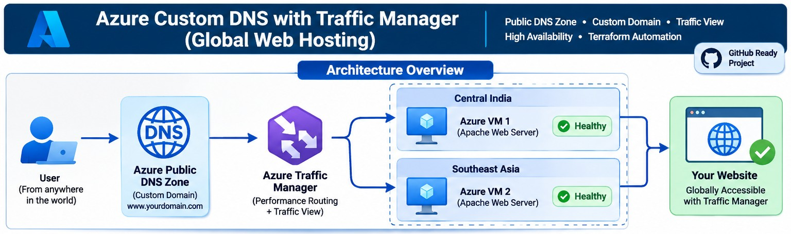

# Azure Custom DNS and Traffic Manager with Global VM Web Hosting

Designed and implemented a globally accessible website hosting architecture using Azure Linux Virtual Machines, Azure Public DNS Zones, custom domain configuration, and Azure Traffic Manager.

## Architecture Diagram



---

## Key Features

- Hosted websites using Apache on Azure Linux VMs.
- Configured custom domain names using Azure Public DNS.
- Implemented DNS-based traffic routing using Azure Traffic Manager.
- Enabled Performance-based regional routing.
- Configured endpoint health monitoring and automatic failover.
- Enabled Traffic View for geographic traffic analysis.
- Automated infrastructure provisioning using Terraform.

## Technologies

Azure, Linux, Apache, Azure DNS, Traffic Manager, Terraform, Bash, GitHub.

## Learning Outcomes

- Azure public DNS administration.
- Custom domain and DNS delegation.
- Global traffic routing.
- Infrastructure as Code.
- High availability and disaster recovery.
- DNS troubleshooting and endpoint monitoring.

## Commands used for authentication 

- Log in to Azure
```
- az login
```

- Create Service Principal 
```
az ad sp create-for-rbac -n az-demo --role="Contributor" --scopes="/subscriptions/$SUBSCRIPTION_ID"
```
Note: Use the values generated here to export the variables in the next step

- Set env vars so that the service principal is used for authentication

```
export ARM_CLIENT_ID=""
export ARM_CLIENT_SECRET=""
export ARM_SUBSCRIPTION_ID=""
export ARM_TENANT_ID=""
```

## Cleanup

To avoid unnecessary Azure charges:

```bash
cd terraform
terraform destroy
```

## NOTE:- 
It is not safe to push a terraform.tfvars file to a public GitHub repository if it contains any sensitive information, passwords, API keys, tokens, or private configuration data.


